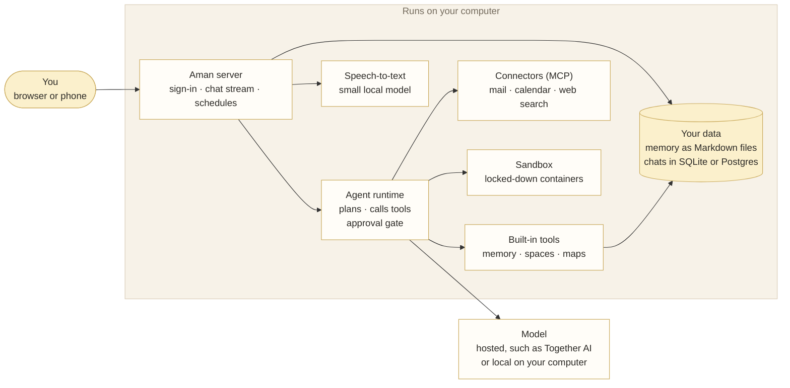

<p align="center">
  
</p>

<h1 align="center">Amanuensis</h1>

<p align="center">
  <strong>A chief of staff that lives on your own computer.</strong><br>
  It knows your life, keeps track of what you'd otherwise forget, and never does anything without your knowledge.
</p>

<p align="center">
  <a href="LICENSE"></a>
  
  
</p>

<p align="center">
  <a href="#get-started"><strong>Get started</strong></a> &nbsp;·&nbsp;
  <a href="docs/AMANUENSIS_ATTRIBUTION.md">What we built</a> &nbsp;·&nbsp;
  <a href="docs/privacy.md">Privacy</a>
</p>

<p align="center">
  
</p>

---

## Why

Most AI assistants are built for people who already live in software: a keyboard, a prompt, patience for a wall of text, and a willingness to send their life to someone else's server.

Most people run a household, not a terminal. They carry the flyer, the bill, the form, the appointment and the thing they promised someone, and they carry it in their head, because nothing was built to carry it for them.

Amanuensis is built for them. You give it a name (ours is Mannie). It wakes up before you do and has the day sorted. It drafts the email, then waits for you to say send. You never write a prompt: you say what's going on, the way you'd say it to a friend, and it takes it from there.

## Get started

You need Docker, `git`, about 10 GB of free disk space, and Linux or macOS. On Windows, use [WSL2](https://learn.microsoft.com/en-us/windows/wsl/install). Setup takes about 15 minutes.

### Installing on Mac and Linux

```bash
git clone https://github.com/ClimbOutLabs/amanuensis && cd amanuensis
./installer/install.sh
```

The installer checks your computer first and tells you in plain words if something is missing. It shows its plan and asks before it changes anything. At the end it prints the address to open in your browser. It also sets up sign-in, backups and phone access, and leaves an `aman` command for health checks (`aman doctor`) and upgrades.

### Installing on Windows

On Windows, Amanuensis installs inside [WSL 2](https://learn.microsoft.com/en-us/windows/wsl/install), the Windows Subsystem for Linux, with Docker Desktop, by running the project's install script. Follow these steps in order.

**1. Install WSL 2 with Ubuntu.** Open PowerShell as an administrator and run:

```powershell
wsl --install -d Ubuntu
```

Restart when it asks. Then open **Ubuntu** from the Start menu once, and set the Linux username and password it asks for. [Microsoft's WSL guide](https://learn.microsoft.com/en-us/windows/wsl/install) has the details.

**2. Install Docker Desktop.** Get it from [Docker's Windows install page](https://docs.docker.com/desktop/setup/install/windows-install/) and install it. Start Docker Desktop and wait until it reports it is running. Then open its **Settings**, go to **Resources, WSL Integration**, turn on Ubuntu under **Enable integration with additional distros**, and choose **Apply & Restart**. If that page shows only one switch, for the default distro, follow the **Go to classic Settings** link at the top of the Settings page instead: the classic page has the same WSL Integration page, with the list of distros.

**3. Get the code.** In the Ubuntu window:

```bash
sudo apt update && sudo apt install -y git
git clone https://github.com/ClimbOutLabs/amanuensis.git
cd amanuensis
```

**4. Run the install.** Still in the Ubuntu window:

```bash
./installer/install.sh
```

The script checks the computer first, then shows its plan and asks before it changes anything. It asks its questions one at a time: the email address you will sign in with, what Aman should call you, a password to choose, and a few setup choices. It does not ask for a model key. You add the key after the install, under **Settings, Models**, which the steps after this section walk through.

**5. Open Aman.** The script checks Docker, builds and installs everything, and prints the address to open in your browser. Sign in with the email and password from step 4.

**Upgrading.** In the Ubuntu window, in the same `amanuensis` folder, run `git pull`, then run `./installer/install.sh` again. It keeps your data and carries on.

**If something looks missing.** Commands like `apt` only exist inside the Ubuntu window. If a terminal says a distro or a package tool is missing, you are in PowerShell or in Docker Desktop's own system, not Ubuntu. Open **Ubuntu** from the Start menu.

**If Docker is not connected to Ubuntu.** The install script may say Docker did not answer, or Ubuntu itself may say the docker command could not be found in this WSL 2 distro. Both mean the same thing: Docker Desktop is running, but its integration with Ubuntu is off. Open Docker Desktop, go to **Settings, Resources, WSL Integration**, turn on Ubuntu under **Enable integration with additional distros**, and choose **Apply & Restart**. Then, in the Ubuntu window, `docker version` must print a Server section. Once it does, run `./installer/install.sh` again.

**1. Get a Together AI key.** Aman needs a model to think with. [Together AI](https://www.together.ai) hosts open models and is the quickest way to start.

- Sign up free at [api.together.ai](https://api.together.ai).
- Open **Settings, API keys** ([direct link](https://api.together.ai/settings/projects/~current/api-keys)) and create a key.
- Copy it. It is shown only once.

**2. Add it to Aman.** Open Aman and go to **Settings**, then **Models**. Together AI is built in: under **Available**, find **together** and click **Configure**. Paste the key you copied into the **API key** field and click **Create**. Nothing else to fill in: the address and the models come with it.

Its models are now on your list. Pick the one you want in the menu under the message box.

**3. Give your chief of staff a name and a personality.** Go to **Settings, Personalization**, and find **Assistant profile**. It has three fields:

- **Name**: what you'll call it. Ours is Mannie.
- **Voice guidance**: one line on how it talks, such as "Warm, direct, concise".
- **Identity**: a few sentences on how it sees its job.

While you're there, add your own name and a line about yourself at the top of the page, so it knows who it works for. Save, and the new name shows up everywhere straight away.

Not sure what to write? Start from one of these and copy its two fields in. Change anything you like.

| Personality                                                    | Good for                                                                                 |
| -------------------------------------------------------------- | ---------------------------------------------------------------------------------------- |
| [The steady hand](docs/personalities/steady-hand.md)           | Calm and organised. For when your days feel like too much.                               |
| [The straight shooter](docs/personalities/straight-shooter.md) | No padding, no pep talk. For when you want the answer and nothing else.                  |
| [The warm friend](docs/personalities/warm-friend.md)           | Kind and encouraging. For the reply you've been avoiding.                                |
| [The coach](docs/personalities/coach.md)                       | Keeps you moving. For when you're behind or keep meaning to do things.                   |
| [The planner](docs/personalities/planner.md)                   | Thinks ahead. For busy households, trips, moves and anything with a lot of moving parts. |

None of these change what it's allowed to do. Sending, deleting and installing still wait for your OK, whatever personality you pick.

**4. Go say hello.** Open the home screen and tap **I'm behind**, or just say what's on your mind. Your chief of staff asks one question at a time and takes it from there.

**5. Connect your email and calendar.** This is where it starts carrying things for you. Go to **Settings, Connectors**:

- **Gmail and Google Calendar.** Choose **Google**, then **Connect**. The panel walks you through making your own Google sign-in in about ten minutes, so your mail goes from Google straight to your computer and nobody else is in between. Connect mail first, then **Connect Calendar**. [Step-by-step guide](docs/google.mdx).
- **Any other mailbox or calendar.** Choose **Email** for an IMAP mailbox (Outlook, iCloud, Fastmail and most others), and **Calendar** for a CalDAV calendar.

Reading is quiet. Every draft, send and calendar change shows you a card first and waits for your OK.

Once your mail and calendar are connected, tap **Run my daily brief** on the home screen to see what tomorrow morning will look like.

Prefer another provider? Any service with an OpenAI-compatible API goes in the same way. Fully local models, such as Ollama or an NVIDIA DGX Spark, work too.

More help: [full install guide](docs/install.mdx) · [first steps](docs/try-aman.md) · [Docker Compose or Kubernetes](docs/quickstart.mdx#other-ways-to-run-it) · [deployment security](docs/deployment-security.mdx)

## What it does

- **Start the day already ahead.** Before coffee, it has read the overnight mail and the day's calendar. It tells you the few things that matter, the one that looks wrong, and the one that can wait until Friday.
- **The reply you've been avoiding.** It finds the email that's been sitting there for nine days, drafts it in your voice, shows you, and sends when you say so.
- **The thing you keep meaning to do.** Book the dentist. Cancel the subscription you forgot about. Work out what the letter from the city wants. It does the first step and asks before the rest.
- **It remembers, so you can let go.** Who's allergic to what, that Thursdays are bad, that your mother's appointment moved. All of it on your own machine, where you can read it and change it.
- **Some things should just happen.** The brief every weekday, a look at what you pay for each month, a reminder the evening before. Set once, and it keeps going.
- **You're always in charge.** Every send and every change is shown to you first, exactly as it will happen. Say no, and nothing happens. Afterwards there's a receipt.
- **Your inbox can't boss it around.** A message that says "ignore your instructions" is just a message. Nothing it reads can pretend to be you or slip into its memory as fact.
- **One assistant, many hats.** Make a persona for the job search, the language you're learning or the move. Each one keeps its own memory and notes, walled off from the rest.
- **A place for what you'd lose in chat.** The meal plan, the medicine schedule, the moving checklist. It goes into a space: a living page that updates in place while the chat scrolls away.
- **It's yours to keep.** Your memory is plain files on your disk. Back it up, export it, move it to a new machine, and it comes with you.

## See it

### The morning brief

Every morning it reads the mail and the calendar and puts the day on one page: the top action item, what came in and who's waiting, replies drafted in your voice, every appointment with how to get there and when to leave, and tomorrow at a glance.

<p align="center">
  
</p>

### Leave on time, and see every step

It works out when to leave for each appointment. Activity, on the right, records every step it took and why it was allowed.

<p align="center">
  
</p>

### Spaces

A living page with its sources, kept up to date by the assistant. Ask it to change something and the page updates in place.

<p align="center">
  
</p>

### Memory you can read

Every memory is one plain sentence you can search, edit or forget.

<p align="center">
  
</p>

### Personas

Each persona has its own name, model, role and knowledge library.

<p align="center">
  
</p>

## Your data, your rules

Your memory, chats, personas and settings live on your computer. Memory is plain Markdown files you can open in any text editor; [docs/memory.md](docs/memory.md) explains how it works.

Be clear about one thing: **the model sees what you send it.** If you use a hosted model, the company running it sees each chat, including what Aman knows about you and anything it reads for you. To keep everything on your computer, use a local model. Web searches, maps and connectors still reach their own services. [docs/privacy.md](docs/privacy.md) lists exactly what goes where.

Sending a message, deleting anything and installing anything always wait for your OK. That rule is enforced in code, on the tool itself, not left to the model's good behaviour.

## What we built

Aman began as a fork of [TrueForge](https://github.com/truefoundry/trueforge), an open-source agent harness from TrueFoundry, on 24 August 2026. Since then: **796 merged pull requests of our own, about 783,000 lines added, and test files up from 820 to 1,769.** Fewer than half of TrueForge's files are untouched.

From TrueForge came the agent runtime, tool calling, the approvals framework, sessions, the HTTP server, storage, model providers, MCP support and the UI toolkit. Everything that makes it Amanuensis was built on top: memory, personas, spaces, the morning brief, mail and calendar, the approval cards, the security guards, the installer, the demo world and the look.

The full accounting, area by area with pull request numbers and the git commands to check it, is in [docs/AMANUENSIS_ATTRIBUTION.md](docs/AMANUENSIS_ATTRIBUTION.md).

Amanuensis was built for the Nebius × NVIDIA Global AI Hackathon and runs on NVIDIA Nemotron through Nebius Token Factory. [docs/token-factory.md](docs/token-factory.md) explains which model does which job, what it costs, and how the cost shows under each answer.

## How it works



Every tool call passes the approval gate first. Reading and searching run on their own; sending, deleting and installing wait for your OK. Mail (Gmail or any IMAP mailbox) and calendars (Google or CalDAV) each run in their own container, and web search uses Tavily. Memory, spaces and maps are built into the server. Speech-to-text and memory search run on small local models. What reaches outside services is the model you chose, web searches, map lookups and the mail and calendar calls you approve; [docs/privacy.md](docs/privacy.md) has the full list.

## For developers

> `main` is active development. Tagged builds are under [Releases](https://github.com/ClimbOutLabs/amanuensis/releases).

The fastest working setup is standalone mode: one process, SQLite, no database server. You need Node.js 22.14 or newer and pnpm through Corepack.

```bash
git clone https://github.com/ClimbOutLabs/amanuensis && cd amanuensis
corepack enable
pnpm install --frozen-lockfile
cp packages/trueforge/.env.example packages/trueforge/.env
pnpm dev:login   # in a second terminal; prints the OIDC_* lines for .env
# add those lines and PUBLIC_BASE_URL=http://localhost:3000 to packages/trueforge/.env, then:
pnpm standalone:dev
```

Open `http://localhost:3000`, sign in with the account `pnpm dev:login` printed, and connect a model under **Settings, Models**. [docs/quickstart.mdx](docs/quickstart.mdx) walks through it, including troubleshooting.

Before you push:

```bash
pnpm verify   # secret scan, format, lint, types, build and tests
```

Read [AGENTS.md](AGENTS.md) and any package-level `AGENTS.md` before changing code. Generated SDK and OpenAPI files are never edited by hand.

<details>
<summary><strong>Repository layout</strong></summary>

| Path                      | Purpose                                                           |
| ------------------------- | ----------------------------------------------------------------- |
| `packages/trueforge`      | HTTP server, storage, providers and Aman's host features          |
| `packages/trueforge-core` | Agent runtime, tool orchestration and session contracts           |
| `packages/frontend`       | The browser app                                                   |
| `packages/trueforge-ui`   | UI components and server-facing UI contracts                      |
| `packages/trueforge-sdk`  | Generated TypeScript SDK                                          |
| `packages/amanuensis`     | `npx amanuensis`: server and chat UI with one command             |
| `packages/aman-installer` | Single-file installer program for Windows, Mac and Linux          |
| `installer`               | The one-command installer and the `aman` command it leaves behind |
| `charts`                  | Helm chart for Kubernetes                                         |
| `demo`                    | Maya's demo world: example data, scripts and the runbook          |
| `mcp`                     | The Gmail MCP connector                                           |
| `docs`                    | Product, setup, architecture and API docs                         |
| `ops`                     | Design records, evaluations and runbooks                          |

</details>

<details>
<summary><strong>Further reading</strong></summary>

- [Introduction and architecture](docs/introduction.mdx)
- [Models, roles and personas](docs/model-roles.mdx)
- [MCP connectors](docs/mcp-servers.mdx)
- [Safety](docs/safety.md) and [privacy](docs/privacy.md)
- [How memory works](docs/memory.md), the [memory design](ops/memory/DESIGN.md) and the [operations runbook](ops/memory/RUNBOOK.md)
- [Sandbox](docs/sandbox.mdx), [schedules](docs/schedules.md), [backups](docs/backup.md), [voice input](docs/voice-input.mdx)
- [Upstream sync runbook](docs/UPSTREAM_SYNC.md) and [divergence policy](DIVERGENCE.md)

</details>

## License and attribution

Amanuensis is licensed under the [Mozilla Public License 2.0](LICENSE). It is derived from [TrueForge](https://github.com/truefoundry/trueforge) by [TrueFoundry](https://truefoundry.com); those portions are MIT licensed, Copyright 2024-2026 TrueFoundry, and their notices are kept in [NOTICE](NOTICE). Third-party components with their own terms are listed in [THIRD_PARTY_NOTICES.md](THIRD_PARTY_NOTICES.md).


